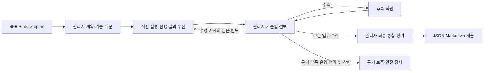

# 목표→AI 회사 자율 협업→최종 산출물: mock-only 수직 경로

2026-11-03 KST. `git pull --ff-only`로 main 625b08b를 반영했다. **목표 한 번과 초기 모의 운영 opt-in 이후, 사용자 중간 업무 결재 0회로 관리자 계획·기준·직원 배분·선행 결과 전달·검토·수정·최종 통합 파일 생성까지 실행되는 별도 경로를 구현했다.** 이번 결과는 모의 공급자에 대한 실행 증거이며 실제 AI 회사 운영 성공은 아니다. 실제 AI API 호출 및 실사용 데이터 변경은 모두 0회다.

## 실행된 결과물

아래 문서는 테스트 성공 문구가 아니라 엔진이 역할별 모의 공급자를 호출하고 실제 저장한 최종 산출물의 사본이다. 모두 mock-only로 표시했다.

| 목표/실행 | 직원 역할 | 모의 호출 | 관리자 수정 | 사용자 중간 업무 결재 | 최종 상태 |
|---|---|---:|---:|---:|---|
| 도서관 이용 안내 | 조사 담당 → 안내 작성 담당 | 6 | 0 | **0** | delivered |
| 매장 재고 인수인계 안내 | 조사 담당 → 안내 작성 담당 | 8 | 1 | **0** | delivered |

- [생성된 도서관 안내 산출물](examples/autonomous_company_library_20261103.md): 방문 준비·이용 등록 확인·자료 검색·대출/반납 조건 확인 순서와 미확인 운영 정보를 담았다.
- [생성된 재고 인수인계 산출물](examples/autonomous_company_stock_20261103.md): 최초 담당자 누락을 관리자가 지적하고, 마감 담당자와 확인 절차를 직원이 보완한 뒤 후속 안내문에 최신 결과를 전달했다.

최신 증거의 상태와 JSON/Markdown 파일은 다음 위치에 남아 있다.

- 도서관: `/tmp/ai_company_os_goal_to_result_mock_20261103_v2/company-b71c0ed555c344e3a6c678f095681a26.json`, 같은 루트 `artifacts/company-b71c0ed555c344e3a6c678f095681a26/final.json` 및 `final.md`.
- 재고: 같은 루트의 `company-729549b18c9f439488f735a75da30764.json`, `artifacts/company-729549b18c9f439488f735a75da30764/final.json` 및 `final.md`.
- 실행 요약: `/tmp/company_vertical_demo_manifest_20261103_v2.json`.

`python -B /tmp/generate_company_vertical_evidence_v2.py`로 외부 socket/DNS/AI transport를 차단하고 실제 AI 활성화를 0으로 둔 상태에서 생성했다. 저장 후 별도 Python 프로세스가 상태와 산출물 hash를 다시 읽어 delivered·업무 결재 0회를 확인했다. JSON에는 최초/수정 직원 버전, 관리자 평가·기준별 model_claim, 최종 통합·각 최신 결과 hash 참조가 보존된다. 위 도메인별 업무 내용은 개발용 가짜 공급자의 출력이며 실제 기관 규정이나 현장 사실을 검증한 결과가 아니다.

## 제품 목표와 기존 구현의 충돌 해소

기존 수동 승인은 제품의 최종 목표가 아니라 이행 단계의 기술적 부채라는 최상위 원칙을 적용했다. 기존 실사용 API를 약화하거나 가짜 사용자 승인을 생성하는 대신, **다른 저장 스키마·별도 namespace·명시적 autonomous_mock 모드**로 분리했다.

| 기존 수동 흐름 | 이번 자율 모의 경로에서 결정 주체 |
|---|---|
| 계획 사용자 승인 | 관리자가 낸 계획을 구조·의존성 검사 후 `adopted_by=ai_manager`로 채택 |
| 품질 기준 사용자 작성/승인 | 같은 관리자 응답이 목표별 기준과 업무별 기준 연결을 생성 |
| 직원 결과 사용자 승인 | 관리자 평가의 accept/revise/stop 판단, 시스템은 계약·근거 상태 일관성 검사 |
| 관리자 proceed 사용자 수락 | 선행 직원 결과를 AI 관리자가 수락한 경우에만 의존 업무에 전달 |
| 수정 요청·재검토 사용자 승인 | 관리자 revise 지시 → 직원 재작성 → 관리자 재검토, 운영 상한 안에서 진행 |
| 최종 결과를 만들기 위한 사용자 결재 | 관리자 최종 통합·평가와 최신 결과 참조 검증 후 delivered 파일 제출 |

**사용자 대리 승인 없음:** 새 상태에 `approved_by=사용자`, `reviewed_by`, `pending_user_decision` 같은 기존 결재 필드를 넣지 않았다. `ai_manager_decision`, `ai_employee_result`, `manager_directive_applied`, `system_safety_stop` 등 역할별 출처를 별도로 기록한다. 테스트는 기존 사용자 결정·직원 승인·semantic 설정·수동 직원 실행 API를 호출하면 실패하도록 차단한 상태에서 전체 자율 경로를 실행했다.

계획·기준·업무 판단은 provider 응답에서 나온다. 엔진에는 도서관/재고/영상 규칙이나 특정 TASK ID·분량·팁 개수·품질 기준 상수가 없다. 도메인 예제는 `tests/support/autonomous_company_fixtures.py`에만 있다. **동일한 관리자 공급자 인스턴스**도 목표 입력을 달리하면 서로 다른 계획·기준을 반환하는 사례를 검증했다. 이는 실제 모델의 지능을 증명하는 것이 아니라 엔진이 역할 출력에 종속돼 움직이며 고정 업무 판단을 대신하지 않는다는 검증이다.

## 새 실행 구조와 변경 파일

- **autonomous_company.py**: Store·Company·명시적 MockManagerProvider/MockEmployeeProvider, 계획/기준/DAG·직원 결과·관리자 평가·최종 산출물의 엄격 계약, 제한된 실행 상태 기계와 모의 원장을 구현했다. 기존 앱의 승인 API나 live 엔진은 호출하지 않는다.
- **app.py**: 새 모의 namespace의 읽기 전용 `/autonomous/mock/<id>` 화면과 홈의 모의 실행 목록만 연결했다. 기존 프로젝트는 수동 모드라고 구별한다. 새 화면은 진행·기준·직원 결과·수정·관리자 근거·불확실성·최종 결과를 보여주며 업무 결재/실제 호출/실행 버튼은 없다. 저장소 조회만으로 디렉터리를 만들지 않는다.
- **tests/support/autonomous_company_fixtures.py**: 출처가 분리된 관리자/직원 가짜 응답을 제공한다. 선행 결과·수정 의견을 실제 입력으로 받아 후속 결과와 최종 통합 응답을 생성한다. 제품용 판단 규칙이나 live provider가 아니다.
- **tests/test_autonomous_company.py**: 종단간 두 목표·동일 공급자의 목표별 기준·수정·운영 중단·안전 차단·새 프로세스 조회·재개·화면·저장 경합 검증 13개.
- 이 보고서 및 위 생성된 산출물 사본 Markdown 2개.

기존 `manager_plan`의 수동 계획, `manager_decision.require_proceed`의 live 사용자 승인, `execution_engine`, `semantic_review`, `ai_safety`, `ai_provider_adapter`, `project_budget`와 owner 호출 도구는 수정하지 않았다. 기존 프로젝트를 새 상태로 복사/이관하지 않았다.

기본 모의 한도는 전체 역할 호출 20회, 업무별 수정 1회·전체 수정 2회다. 설정 범위에도 상한을 두고 모델이 한도를 바꿀 수 없게 했다. plan/execute/review/finalize가 모두 모의 원장을 소모한다. revision은 관리자의 새로운 업무 지시에 따른 재작성이며 실패한 외부 요청의 자동 재시도가 아니다.

각 호출의 reserved·context hash·역할·공급자·KST를 먼저 원자 저장/fsync하고, 응답 처리와 상태 적용을 구별한다. completed라도 미적용 active_operation이 있으면 재개 시 재호출하지 않는다. 저장 hash와 낙관적 비교·프로세스 lock으로 변경/경합을 감지한다. lock 지원이 없는 환경은 실행을 거절하며 기존 수동 앱 import를 깨뜨리지 않는다. 해시는 운영 권한 서명이 아니며 실제 권한 승인 기능을 대신하지 않는다.

모든 선행 업무가 관리자 수락 상태여야 최신 버전을 다음 직원에게 전달한다. 최종 관리자 응답은 현재 직원 버전/hash를 정확히 참조하고 모든 선언된 기준에 대한 일관된 met 평가가 있어야 제출된다. unknown을 accept/deliver로 숨기면 거절한다. 불가능한 목표는 관리자 plan 단계 stop으로 직원 호출 없이 종료할 수 있다. 외부 자료·예산·외부 권한이 필요한 경우만 needs_operational_permission으로 구별한다. 업무 내용 선택용 ask_user는 정상 경로로 허용하지 않는다.

## 재개·실패 증거

- 도서관 성공: 계획 → 조사 → 관리자 수락 → 작성 직원이 선행 결과 수신 → 관리자 수락 → 관리자 통합 → 파일. 사용자 업무 결재 0회.
- 재고 수정: 최초 버전/누락 근거 보존 → 관리자 revise → 직원 새 버전 → 관리자 accept → 후속 직원에는 수정된 최신 버전만 전달 → 최종 파일. 업무/기준/수정 결재 0회.
- unknown 사실, 반복 revise, 모의 예산 소진, provider 오류/timeout은 stopped로 끝나고 후속/최종 파일을 성공으로 만들지 않는다. 예외 메시지의 비밀용 sentinel은 기록하지 않는다.
- 가짜 사용자 승인 metadata, 잘못된 의존 관계/순환, 허위 unknown 수락, 업무 질문으로 중간 사용자 결정을 요구하는 응답은 거절한다.
- reserved 상태의 프로세스 중단 또는 completed지만 상태 미적용인 중단은 uncertain_operation으로 정지하고 호출을 반복하지 않는다. 반대로 계획 적용이 끝난 정상 체크포인트는 재계획 없이 나머지만 이어간다.
- 완료 프로젝트 재실행은 동일 산출물을 재조회할 뿐 provider 호출이나 파일 재작성을 하지 않는다. 다른 프로세스의 재조회 및 산출물 hash 검사, 상태/산출물 변경·동시 저장·중복 실행 lock 차단을 검증했다.
- 실제 공급자 객체는 타입 검사에서 거절한다. 새 provider metadata/환경변수로 live 모드가 선택되는 경로는 없다. 이 검증의 가짜 콜백은 신뢰된 개발 fixture이며 외부 플러그인 sandbox나 실제 AI 연결 기능은 아니다.

## 테스트 명령과 결과

`python -B -m unittest tests.test_autonomous_company`를 개발 단계마다 실행했다.

| 로그 | 실제 실행 수 | 결과 |
|---|---:|---|
| `/tmp/company-core-first.log` | 6 | 모두 통과, 0.889초 |
| `/tmp/company-core-second.log` | 6 | 모두 통과, 0.875초 |
| `/tmp/company-ui-tests.log` | 9 | 모두 통과, 1.972초 |
| `/tmp/company-vertical-final.log` | 10 | 모두 통과, 1.139초 |
| `/tmp/company-vertical-final2.log` | 11 | 모두 통과, 1.542초 |
| `/tmp/company-core-complete.log` | 13 | 모두 통과, 1.441초 |

기존 수동 흐름과 운영 보호를 포함한 집중 회귀:

- `python -B /tmp/run_company_vertical_regression.py > /tmp/company-vertical-regression.log 2>&1` → **331개 모두 통과**, 실패·오류 0, 28.791초.
- 예제 산출물 내용을 구체화한 fixture까지 포함한 최종 실행 `python -B /tmp/run_company_vertical_regression.py > /tmp/company-vertical-final-regression.log 2>&1` → **331개 모두 통과**, 실패·오류 0, 30.414초.

runner는 서명키를 임시 경로로 격리하고, 새 자율 회사 13개와 이전 업무 연결·명시 답변·관리자 결정/pending 검토·무료 어댑터·owner 호출 경계·직원 실행/사용자 승인·최종 보관·의미 검토·예산·동시성 모듈을 실행한다. 기존 fixture import/상속에 따른 반복 사례가 실행 수에 포함된다. 초기/최종 미해결 테스트 실패는 없다.

전체 테스트·실제 HTTP 소켓 서버·브라우저 검증은 실행하지 않았다. Handler GET으로 읽기 화면/홈 링크/404를 검증했으며 HTTP 서버 통과로 표현하지 않는다. 실제 JSON/키를 fixture로 사용하지 않았고 외부 socket/DNS/transport 및 기존 수동 승인 API를 테스트에서 차단했다. 테스트 수보다 위 실제 저장 산출물과 역할 간 전달·수정·무중간결재 증거를 완료 근거로 삼았다.

## 실사용 보존

사전 data/backups **29개**, 기존 미추적 파일 6개, 총 35개 목록·SHA-256을 기록했다. 사후 **35개 전부 SHA 동일**, data/backups 목록도 완전히 일치한다. 이번에는 실제 프로젝트 JSON을 한 번도 저장하지 않았다. 다른 프로젝트 c85d9853906a의 미확정 예약과 모든 기존 guard/관측·백업도 그대로다. 새 서명키/중복 백업/실사용 guard는 생성하지 않았다.

cb44b605b498는 **9/20, completed 9, failed/reserved 0, 잔여 11** 그대로다. TASK-001/002 완료·사용자 승인, TASK-003/004 대기·결과 없음, 마지막 ask_user의 answered 기록 및 앞 8번째 finish_reason 중단·모든 승인/원장은 불변이다. 실제 AI API 호출·자동/수동 전송·유료 사용·새 공급자 연결·실사용 전환·업무 승인/기준 확정은 모두 0회다.

## 원칙 문서 참조 점검

- **시작:** AI_COMPANY_OS_CORE_PRINCIPLES.md, AGENTS.md 전체와 한국어 규칙을 먼저 읽었다. 직전 보고서의 “품질 기준/관리자 proceed를 사용자가 반복 승인” 경로를 최종 목표로 삼지 않았다.
- **중간:** 두 문서의 사용자 중간 결재 제거·AI 역할 소유권·mock/live 분리·운영 비용/전송 경계 조항을 다시 대조했다. 별도 mock 상태 기계와 AI 관리자 감사로 다섯 중간 업무 결재를 대체하고, 기존 live 승인은 그대로 둬 충돌을 해소했다.
- **종료:** 동일 기준으로 사용자 업무 승인 요청 0회, 제품 코드의 도메인 고정 판단 없음, 산출물 생성·새 프로세스 재조회, 실사용 35개 파일 보존을 재검사했다. 두 원칙 문서는 수정하지 않았다.

## 현재 한계와 실제 운영 전환에 남은 일

목표 입력은 `Store.create(goal, opt_in=True)`와 `Company(...).run(id)`의 로컬 API다. 가짜 공급자를 명시적으로 주입해야 하며 제품의 기본 공급자를 가짜 지능으로 꾸며 넣지 않았다. 웹에는 저장된 모의 실행의 읽기 전용 화면만 연결했다. 본 증거는 별도 `/tmp` namespace에서 생성됐고 보고서 사본으로 열람할 수 있다. 기존 서버의 기본 저장 위치에 증거를 복사하거나 실사용 프로젝트를 자동 변환하지 않았다.

이번에 완성한 것은 **mock-only 자율 업무 엔진의 최소 수직 경로**다. 실제 AI로 일반 목표를 달성하는 품질·신뢰성은 아직 검증하지 않았다. 자동 재계획/재배분은 이번 최소 경로에 없고, 실행 불가·불확실성은 관리자 근거를 남겨 안전 정지한다. 독립 출처/현장/도구 검증도 없으며 모델의 met는 사실 증명이 아니다.

실제 연결은 다음 별도 설계·검증이 필요하다.

1. 프로젝트 목표·자료 범위·관리자/직원 역할별 전송·허용 모델·전체 호출/비용·수정/복구 상한을 묶는 **운영 범위 동의**. 현재 건별 승인이나 이번 문서만으로 이를 획득했다고 간주하지 않는다.
2. 이번 모의 attempts를 실제 real_ai 원장으로 바꾸는 것이 아니라, 기존 ai_safety의 동의·선예약·미확정 예약·무료-only·고정 HTTPS·2회/시작·90초 이하 timeout·크기 한도·무재시도 규칙과 새 자율 상태의 안전한 연결. 실제 키/adapter는 승인된 live 경계에서만 사용해야 한다.
3. 초기 운영 한도 안에서 자동 단계 실행을 이어가는 스케줄/재개 권한, 중복 전송/불확실 예약 처리, 공급자 응답 계약·데이터 격리·최종 근거 검증. 실패 복구의 자동 호출은 별도 명시된 허용 정책 없이는 켤 수 없다.
4. 신규 실제 모드와 기존 수동 프로젝트의 격리·명시적 마이그레이션 및 제한된 실제 end-to-end 검증. 기존 cb44...나 다른 프로젝트를 이 작업으로 자동 이관하지 않는다.

다음 사용자에게 요청할 대상은 계획·품질 기준·proceed·직원 결과의 반복 결재가 아니라, 충분히 구체화해 검토 가능한 **실제 운영 범위와 외부 호출/비용 한도**여야 한다. 그 범위 안의 업무 판단은 AI 관리자/직원이 담당해야 한다. 현재 실사용 자동 호출은 활성화하지 않고 이 경계 앞에서 종료한다.

최종 `git diff --check` 통과, 보고서·두 생성 산출물 재읽기, 원칙 문서 종료 점검, 35개 보존 파일 SHA 및 data/backups 목록 대조를 완료했다. 코드·테스트·보고서와 모의 산출물 사본만 선택적으로 커밋·푸시하고 원격 main을 확인한다. 실사용 프로젝트 원문·키·guard·실제 모델 응답은 포함하지 않는다.
